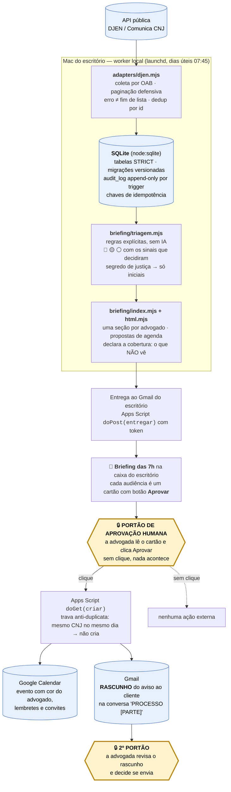
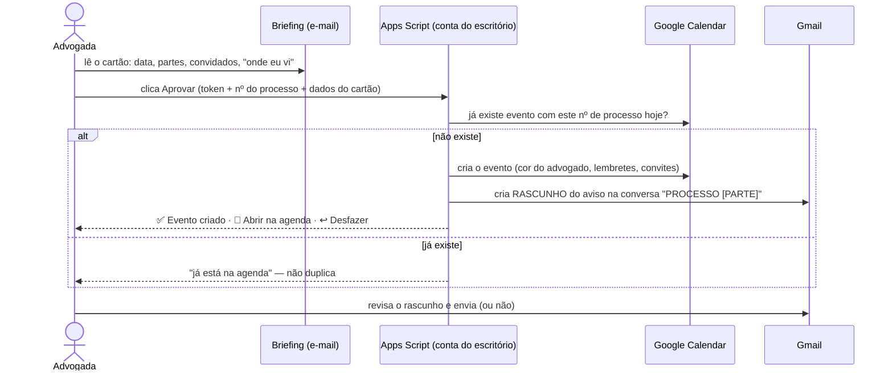

# Arquitetura

Um pipeline curto, determinístico e com **um portão humano** antes de qualquer
efeito no mundo. Esta página mostra o fluxo de ponta a ponta, onde fica cada
invariante e como a esteira de CI os protege. A especificação do produto está em
[PRODUTO.md](PRODUTO.md); as decisões, em [docs/adr](docs/adr/README.md).

## O fluxo — da coleta à agenda



**Onde está o portão:** entre o e-mail e qualquer efeito externo. O sistema só
*propõe*; criar o evento e avisar o cliente exigem, cada um, um gesto humano. O
aviso ao cliente nunca sai automaticamente — nasce rascunho, sempre.

### O clique, em detalhe



## Duas peças em produção — e qual faz o quê

| Hora | O quê | Quem executa |
|---|---|---|
| 07:00 | monta o e-mail das 7h (Gmail + Agenda + alertas de publicação) | rotina agendada de Claude na nuvem, com conectores |
| 07:15 | envia o e-mail ao escritório | Apps Script na conta do escritório |
| 07:45 | coleta DJEN, grava no SQLite deduplicado, tria por regras, arquiva o briefing determinístico | **worker local** (launchd) |
| 08:00 | alarme se o e-mail das 7h não chegou | Apps Script (vigia-do-vigia) |
| ▶ | clique em Aprovar → evento + rascunho do aviso | Apps Script, sob aprovação humana |

Honestidade importa aqui: o **worker local é a fonte da verdade do Diário** (só
ele alcança o DJEN, que bloqueia IP de datacenter) e é dele a triagem explicável;
o texto do e-mail das 7h ainda é montado pela rotina da nuvem, que enxerga Gmail
e Agenda. O canal para o briefing determinístico virar o e-mail das 7h existe e
está testado (`--entregar`); ligá-lo é o próximo passo.

## Módulos

```
src/core/db.mjs              abre o SQLite, aplica migrações em ordem, transação
src/core/migrations/*.sql    schema versionado — toda tabela STRICT; triggers de audit_log
src/core/auditoria.mjs       registrar() na trilha append-only; criarLog() sanitiza teor
src/core/idempotencia.mjs    reservar() ANTES da chamada externa → concluir()/falhar()
src/core/segredos.mjs        Keychain do macOS via `security` (argumentos, nunca shell)
src/core/escritorio.mjs      identidade do escritório: do config (fora do git) ou exemplo fictício
src/core/prazos/             calendário por tribunal + motor de prazos (fechado: requerConfirmacao)
src/core/briefing/           triagem.mjs (regras) · index.mjs (modelo) · html.mjs (e-mail)
src/adapters/djen.mjs        cliente DJEN: paginação defensiva, retry, dedup, coletarDjen()
src/scripts/                 gerar-briefing (CLI) · cargas de feriados e obrigações
src/worker/                  fila de jobs no próprio SQLite · heartbeat · ponto de entrada
deploy/                      Apps Script do escritório (envio, vigia, botão Aprovar) · launchd
ferramentas/                 auditoria de vazamento · lint · cobertura · conferidor do README
tests/                       suíte hermética (node:test)
spikes/                      Fase 0 — código descartável, em Node e Python
```

### Dados

SQLite em arquivo único no Mac do escritório, **17 tabelas STRICT**:

- **Ingestão**: `fontes_execucao` (uma linha por fonte por execução; `completo`
  nunca é presumido), `comunicacoes` (DJEN, deduplicadas por id), `comunicacoes_oab`
  (a quais OABs cada uma foi dirigida).
- **Domínio**: `processos`, `partes` (destinatário de e-mail nunca sai de documento
  — sai daqui, e só se validado), `documentos`, `extracoes`, `fatos`, `obrigacoes`
  (parcelas de acordo), `feriados` e `regras` (calendário e regra de contagem por
  tribunal, tudo com `confirmado_em NULL` até validação humana).
- **Ação sob aprovação**: `acoes_propostas` → `aprovacoes` → `execucoes` (a chave
  de idempotência é UNIQUE aqui e é gravada antes da chamada externa).
- **Operação**: `jobs` (fila com transação — duas instâncias nunca pegam o mesmo
  job), `briefing_itens` (o que já foi relatado), `audit_log` (append-only: triggers
  recusam UPDATE e DELETE).

Convenções do schema: dinheiro em centavos (INTEGER), datas em ISO-8601 (TEXT),
booleanos com CHECK (0,1). Sem ORM — o SQL é pequeno e estável.

## Onde vive cada invariante

| Invariante | Onde está | Quem o protege |
|---|---|---|
| Auditoria append-only | triggers em [001_inicial.sql](src/core/migrations/001_inicial.sql); [auditoria.mjs](src/core/auditoria.mjs) | testes "CRÍTICO: UPDATE/DELETE em audit_log é recusado"; lint `auditoria-append-only` |
| Idempotência antes da chamada externa | [idempotencia.mjs](src/core/idempotencia.mjs): `reservar()` → operação → `concluir()` | teste "CRÍTICO: a segunda reserva da mesma chave NÃO autoriza chamar a API" |
| Erro nunca vira "não há nada" | [djen.mjs](src/adapters/djen.mjs): só página curta encerra; erro é falha | testes "CRÍTICO: falha no meio da paginação salva o parcial mas marca 'falhou'"; teste de mutação nos spikes |
| Prazo não é adivinhado | [prazos/index.mjs](src/core/prazos/index.mjs): `APROVADO_PELA_ADVOGADA = false`, `requerConfirmacao` | `tests/prazos.test.mjs`; lint `portao-de-prazos` |
| Segredo fora do disco | [segredos.mjs](src/core/segredos.mjs) (Keychain) | lint `segredo-fora-do-disco`; auditoria de vazamento (formatos de chave) |
| Log sem teor | `criarLog()` em [auditoria.mjs](src/core/auditoria.mjs), sanitização recursiva | teste "log técnico omite conteúdo sensível"; lint `log-estruturado` |
| Dado real nunca no git | `.gitignore`; exemplos fictícios por convenção | guarda de hermetismo em `tests/geral.test.mjs`; [auditoria-vazamento.mjs](ferramentas/auditoria-vazamento.mjs) na árvore e no histórico |
| Nenhuma ação externa sem aprovação | o botão no e-mail é a única porta para agenda e Gmail | desenho: não há código em `src/` que chame Calendar ou Gmail |

## A esteira (CI)

Três jobs independentes em cada push e pull request, só com ações oficiais e
permissão de leitura ([ci.yml](.github/workflows/ci.yml)):

1. **Testes (Node 22)** — `npm ci` prova que o lockfile segue vazio; `npm test`;
   spikes em Node e em Python; cobertura nativa publicada no resumo da execução,
   com a lista do que a suíte não carrega; e o conferidor do README, que conta os
   testes de verdade e falha se badge, tabela ou comentário mentirem.
2. **Lint** — com o que o Node traz: sintaxe, higiene de texto, regras de ESM e as
   regras que encodam as decisões acima.
3. **Auditoria de vazamento** — árvore e **todo o histórico** (blobs, mensagens,
   autoria): CNJ com dígito válido, OAB fora da família fictícia, e-mail fora dos
   domínios de exemplo, segredos em formato conhecido, caminhos proibidos,
   `.gitignore` obrigatório e a lista de termos reais, que vive só como segredo do
   Actions. Qualquer achado derruba o build, com o relatório redigido.
